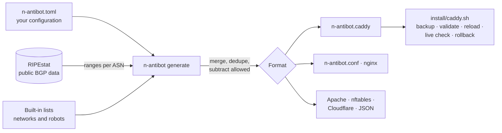

<div align="center">


# N-antibot

**Cut off bot networks and scrapers at your web server. No accounts, no keys, no dependencies.**

[](https://github.com/KrilinZ/N-antibot/actions/workflows/ci.yml)
[](LICENSE)
[](pyproject.toml)
[](pyproject.toml)
[](#-caddy-setup)
[](#-nginx-setup)
[](docs/en/apache.md)
[](docs/en/nftables.md)
[](docs/en/cloudflare.md)
[](docs/en/node-express.md)

[🇪🇸 Español](README.md) · 🇬🇧 English

</div>

---

N-antibot generates a small configuration file for **Caddy**, **nginx**, **Apache**, the **Linux firewall**,
**Cloudflare** or your **Node.js** application that cuts off, before they reach your site, two kinds of visits:

1. Those coming from **cloud server networks** that are a common source of bots pretending to be Chrome
   (Tencent Cloud by default).
2. Those from **robots and scraping libraries** that bring no visitors: Bytespider, MJ12bot, python-requests,
   Scrapy, vulnerability scanners…

Google, Bing, AI crawlers, your customers and `curl` keep getting in as usual.

```console
$ pip install git+https://github.com/KrilinZ/N-antibot.git
$ n-antibot generate -o n-antibot.caddy
n-antibot: 241 IPv4 + 17 IPv6 ranges, 18 robots → n-antibot.caddy
$ sudo ./install/caddy.sh --site example.com --snippet n-antibot.caddy --check-url https://example.com
n-antibot: ok   Chrome    -> 200
n-antibot: ok   Googlebot -> 200
n-antibot: ok   curl      -> 200
n-antibot: ok   Bytespider -> 000
n-antibot: installed: example.com is protected
```

## 📚 Contents

- [Why it exists](#-why-it-exists)
- [What it blocks and what it does not](#️-what-it-blocks-and-what-it-does-not)
- [How it works](#️-how-it-works)
- [Guides by technology and by use case](#-guides-by-technology-and-by-use-case)
- [Requirements](#-requirements)
- [Installation](#-installation)
  - [Caddy setup](#-caddy-setup)
  - [nginx setup](#-nginx-setup)
  - [More technologies](#-more-technologies)
- [Configuration](#-configuration)
- [Built-in lists](#-built-in-lists)
- [Commands](#️-commands)
- [Python API](#-python-api)
- [Keeping the lists fresh](#-keeping-the-lists-fresh)
- [Checking that it works](#-checking-that-it-works)
- [Removing it](#-removing-it)
- [Tests](#-tests)
- [Limits: what N-antibot does not do](#-limits-what-n-antibot-does-not-do)
- [FAQ](#-faq)
- [Project layout](#️-project-layout)
- [Contributing](#-contributing)
- [License](#-license)

## 💡 Why it exists

Commercial anti-bot services (PerimeterX/HUMAN, DataDome, Cloudflare Bot Management) work well, but they usually
require a contract, are billed per request and cannot always be placed in front of any server. For a shop or a small
site, what hurts most is often much simpler: **data-center traffic that will never buy anything** and **scrapers
that do not even hide their name**.

N-antibot was born on a real online shop to cut exactly that, with three principles:

| Principle | What it means |
|---|---|
| **Nothing to sign up for** | No accounts, no API keys, no JavaScript on your site and no Python dependencies. |
| **Do not break the site** | Search engines, AI crawlers, real browsers, `curl` and your webhooks are never touched. A configuration is rejected if one of your rules could cut off a browser or Google. |
| **All or nothing** | If downloading the ranges fails, no file is written. The installer backs up, validates, reloads, checks the live site and rolls back by itself if anything is off. |

## 🛡️ What it blocks and what it does not

| Visit | Default | How to change it |
|---|:---:|---|
| Tencent Cloud (AS132203, AS45090) | ⛔ cut off | `[networks] presets` |
| Alibaba Cloud, Huawei Cloud | ✅ allowed | add `alibaba-cloud`, `huawei-cloud` |
| Any other network (by ASN or by range) | ✅ allowed | `[networks] asns` and `block` |
| Bytespider, MJ12bot, DotBot, BLEXBot, PetalBot, MegaIndex, SeekportBot | ⛔ cut off | `[robots] presets` / `allow` |
| python-requests, python-urllib, Go-http-client, Scrapy, aiohttp, libwww-perl | ⛔ cut off | `[robots] allow` |
| zgrab, masscan, Nuclei, sqlmap, Nikto | ⛔ cut off | `[robots] allow` |
| AhrefsBot, SemrushBot and other SEO tools | ✅ allowed | add the `seo-tools` preset |
| GPTBot, ClaudeBot, CCBot and other AI crawlers | ✅ allowed | add the `ai-training` preset |
| Googlebot, Bingbot, DuckDuckBot, Yandex, Applebot | ✅ always allowed | cannot be blocked by mistake |
| Chrome, Safari, Firefox, mobile browsers | ✅ always allowed | cannot be blocked by mistake |
| `curl`, `wget` | ✅ always allowed | they are your own testing tools |
| Excluded paths (`/.well-known/*` and the ones you add) | ✅ always allowed | `[paths] exclude` |

> [!IMPORTANT]
> AI crawlers are allowed by default on purpose: if you want your site to show up in ChatGPT, Claude or Perplexity
> answers (GEO), do not block them.

## ⚙️ How it works



1. **It downloads the ranges** announced by each autonomous system (ASN) from [RIPEstat](https://stat.ripe.net/),
   which publishes BGP data without an account. There is a timeout, retries with growing waits and validation of
   the answer.
2. **It merges** the ranges (joins adjacent ones, drops nested ones) and **subtracts** the ones you mark as allowed.
3. **It generates** the file for your server. On every request the server looks at the IP and the `User-Agent`; if
   one matches and the path is not excluded, it **closes the connection without answering**. The bot does not even
   get an error: it uses none of your bandwidth and never reaches your application.

<details>
<summary><b>The Caddy detail that is hardest to find out</b></summary>

In Caddy, a `handle @matcher` with a named matcher is sorted **after** every `handle /path/*`. If your site has
`handle /product/*` or `handle /api/*`, a block written as `handle @bots { abort }` would never reach those routes.

N-antibot solves it in two steps: a `rewrite` (which Caddy runs before any `handle`) sends the request to a private
path, and an **exact-path** `handle` (which wins over prefix ones) aborts it:

```caddyfile
rewrite @nAntibotNet /__n_antibot_blocked
rewrite @nAntibotAgent /__n_antibot_blocked
handle /__n_antibot_blocked {
	abort
}
```

The tests start a real Caddy with `handle /producto/*` and check that the cut reaches it too.
</details>

## 📖 Guides by technology and by use case

The full documentation lives in [`docs/en/`](docs/en/README.md). Every guide says what has been tested and what
has not.

| Technology | Guide | What it cuts | Tested |
|---|---|---|:---:|
| Caddy | [docs/en/caddy.md](docs/en/caddy.md) | networks and robots | ✅ |
| nginx | [docs/en/nginx.md](docs/en/nginx.md) | networks and robots | ✅ |
| Apache and `.htaccess` | [docs/en/apache.md](docs/en/apache.md) | networks and robots | ✅ |
| Linux firewall (nftables) | [docs/en/nftables.md](docs/en/nftables.md) | networks only | ✅ |
| Node.js and Express | [docs/en/node-express.md](docs/en/node-express.md) | networks and robots | ✅ |
| Next.js and Vercel | [docs/en/vercel-nextjs.md](docs/en/vercel-nextjs.md) | networks and robots | ⚠️ logic only |
| Cloudflare | [docs/en/cloudflare.md](docs/en/cloudflare.md) | networks and robots | ⚠️ no real account |

| Use case | Ready configuration |
|---|---|
| [Online shop](docs/en/cases.md#-online-shop) | [`shop.toml`](examples/cases/shop.toml) |
| [Blog, magazine or corporate site](docs/en/cases.md#-blog-magazine-or-corporate-site) | [`blog.toml`](examples/cases/blog.toml) |
| [Site with a public API](docs/en/cases.md#-site-with-a-public-api) | [`public-api.toml`](examples/cases/public-api.toml) |
| [WordPress](docs/en/cases.md#-wordpress) | [`wordpress.toml`](examples/cases/wordpress.toml) |
| [Behind a CDN or load balancer](docs/en/cases.md#-behind-a-cdn-or-load-balancer) | [`behind-cdn.toml`](examples/cases/behind-cdn.toml) |
| [Maximum protection](docs/en/cases.md#-maximum-protection) | [`strict.toml`](examples/cases/strict.toml) |
| [No AI crawlers](docs/en/cases.md#-no-ai-crawlers) | [`no-ai.toml`](examples/cases/no-ai.toml) |
| [Cutting before the web server](docs/en/cases.md#-cutting-before-the-web-server) | [`firewall.toml`](examples/cases/firewall.toml) |
| [Several sites on one server](docs/en/cases.md#-several-sites-on-one-server) · [I am being hit from another network](docs/en/cases.md#-i-am-being-hit-from-another-network) · [I blocked someone I should not have](docs/en/cases.md#-i-blocked-someone-i-should-not-have) | |

## 📋 Requirements

| What | Version | What for |
|---|---|---|
| Python | 3.11 or later | Running `n-antibot` (standard library only) |
| Caddy | 2.x | If you use the `caddy` output |
| nginx | 1.x with `geo` and `map` (built in) | If you use the `nginx` output |
| Apache | 2.4 with `mod_rewrite` | If you use the `apache` output |
| nftables | Linux, as root | If you use the `nftables` output |
| Node.js | tested with 24 and 26 | If you use the middleware in `integrations/node/` |
| Internet access | to `stat.ripe.net` | Only when generating the lists, not when serving the site |

Nothing has to be installed on the server itself if you generate the file elsewhere and copy it over.

## 🚀 Installation

```bash
pip install git+https://github.com/KrilinZ/N-antibot.git
```

Or isolated, with [pipx](https://pipx.pypa.io/):

```bash
pipx install git+https://github.com/KrilinZ/N-antibot.git
```

To pin a version, append the tag: `...N-antibot.git@v0.2.0`.

### 🟦 Caddy setup

**1. Create your configuration** (optional: defaults are used without it).

```bash
n-antibot init -o n-antibot.toml
```

**2. Generate the file.**

```bash
n-antibot generate -c n-antibot.toml -o n-antibot.caddy
```

**3. Install it with the safe installer** (on the server, as root).

```bash
sudo ./install/caddy.sh --site example.com --snippet n-antibot.caddy --check-url https://example.com
```

The installer does this, in order, and **rolls back by itself** if anything fails:

| Step | What it does |
|:---:|---|
| 1 | Backs up the `Caddyfile` and the previous file to `/var/backups/n-antibot/<date>/` |
| 2 | Copies the new file to `/etc/caddy/n-antibot.caddy` |
| 3 | Adds `import /etc/caddy/n-antibot.caddy` as the first line of your site block (only once) |
| 4 | `caddy validate` and, if it passes, `caddy reload` |
| 5 | With `--check-url`: Chrome, Googlebot and curl must get an answer, and Bytespider must be cut off |

<details>
<summary><b>Installer options</b></summary>

| Option | Default | Description |
|---|---|---|
| `--site ADDRESS` | (required) | The block to protect, exactly as its line starts in the Caddyfile (`example.com {`) |
| `--snippet FILE` | (required) | The file made by `n-antibot generate` |
| `--caddyfile FILE` | `/etc/caddy/Caddyfile` | Your Caddyfile |
| `--dest FILE` | `/etc/caddy/n-antibot.caddy` | Where it is installed |
| `--backup-dir DIR` | `/var/backups/n-antibot` | Where backups are kept |
| `--address HOST:PORT` | Caddy's own | Caddy admin endpoint used for the reload |
| `--check-url URL` | (none) | Live check after the reload |
| `--uninstall` | | Removes the `import` line and reloads |

</details>

<details>
<summary><b>Manual setup</b></summary>

```caddyfile
example.com {
	# Must be the FIRST line of the block.
	import /etc/caddy/n-antibot.caddy

	handle /api/* {
		reverse_proxy 127.0.0.1:3000
	}
	handle {
		root * /var/www/example
		file_server
	}
}
```

```bash
sudo cp n-antibot.caddy /etc/caddy/n-antibot.caddy
sudo caddy validate --config /etc/caddy/Caddyfile --adapter caddyfile
sudo caddy reload --config /etc/caddy/Caddyfile --adapter caddyfile
```

</details>

> [!NOTE]
> Is your Caddy behind Cloudflare or a load balancer? Set `ip_matcher = "client_ip"` under `[caddy]` and configure
> `trusted_proxies` in Caddy. Otherwise Caddy would see the proxy's IP instead of the visitor's.

### 🟩 nginx setup

**1. Generate the file.**

```bash
n-antibot generate -c n-antibot.toml -f nginx -o n-antibot.conf
sudo cp n-antibot.conf /etc/nginx/n-antibot.conf
```

**2. Include it once inside `http { }`** and add one line to every `server` you want to protect.

```nginx
http {
	include /etc/nginx/n-antibot.conf;

	server {
		server_name example.com;

		if ($n_antibot_block) { return 444; }

		# ... the rest of your configuration
	}
}
```

**3. Validate and reload.**

```bash
sudo nginx -t && sudo nginx -s reload
```

`444` is nginx's special code for **closing the connection without answering**, the same as `abort` in Caddy.

The file defines four variables:

| Variable | Is `1` when… |
|---|---|
| `$n_antibot_net` | the IP is in a blocked network (`geo`) |
| `$n_antibot_agent` | the `User-Agent` matches a blocked robot (`map`) |
| `$n_antibot_excluded` | the path is in `[paths] exclude` |
| `$n_antibot_block` | the request must be cut: network or robot, and the path is not excluded |

> [!NOTE]
> Behind a proxy or CDN, configure nginx's `realip` module (`set_real_ip_from`, `real_ip_header`) so that `geo`
> sees the visitor's real IP.

### 🟨 More technologies

| Your site goes through… | Command | Guide |
|---|---|---|
| Apache or an `.htaccess` | `n-antibot generate -f apache -o n-antibot.conf` | [Apache](docs/en/apache.md) |
| The Linux firewall | `n-antibot generate -f nftables -o n-antibot.nft` | [nftables](docs/en/nftables.md) |
| Cloudflare | `n-antibot generate -f cloudflare \| tail -1` | [Cloudflare](docs/en/cloudflare.md) |
| Node.js or Express | `n-antibot generate -f json -o n-antibot.json` | [Node.js and Express](docs/en/node-express.md) |
| Next.js or Vercel | `n-antibot generate -f json -o n-antibot.json` | [Next.js and Vercel](docs/en/vercel-nextjs.md) |

For anything else (another CDN, fail2ban, your own code), the JSON output carries the plain lists:

```bash
n-antibot generate -f json -o n-antibot.json
```

```json
{
  "generator": "n-antibot 0.2.0",
  "generated_on": "2026-11-12",
  "asns": ["AS132203", "AS45090"],
  "ipv4": ["1.12.0.0/14", "1.116.0.0/15", "…"],
  "ipv6": ["2402:4e00::/32", "…"],
  "user_agents": ["Bytespider", "MJ12bot", "…"],
  "user_agent_regex": "(?i)(Bytespider|MJ12bot|…)",
  "exclude_paths": ["/.well-known/*"]
}
```

## 🧩 Configuration

A single TOML file. **Every key is optional.** Create it with `n-antibot init -o n-antibot.toml`.

```toml
[networks]
presets = ["tencent-cloud"]        # cloud networks to block
asns    = ["AS45102"]              # extra autonomous systems
block   = ["203.0.113.0/24"]       # single ranges you want cut off
allow   = ["43.153.10.20/32"]      # ranges that are NEVER cut (your server, your monitor)

[robots]
presets = ["aggressive-crawlers", "scraping-libraries", "vulnerability-scanners"]
block   = ["BadBot"]               # extra User-Agent fragments
allow   = ["aiohttp"]              # take them out of the built-in lists

[paths]
exclude = ["/.well-known/*", "/api/*", "/webhooks/*", "/health"]

[output]
format = "caddy"                   # caddy | nginx | apache | nftables | cloudflare | json

[caddy]
prefix     = "nAntibot"
block_path = "/__n_antibot_blocked"
ip_matcher = "remote_ip"           # or "client_ip" behind a proxy

[nginx]
prefix = "n_antibot"

[nftables]
table = "n_antibot"
ports = [80, 443]
```

### Full reference

| Key | Type | Default | Description |
|---|---|---|---|
| `networks.presets` | list | `["tencent-cloud"]` | Built-in networks to block. See [lists](#-built-in-lists). |
| `networks.asns` | list | `[]` | Extra ASNs, written as `AS12345`. |
| `networks.block` | list | `[]` | Extra ranges (`203.0.113.0/24`, `2001:db8::/32`). |
| `networks.allow` | list | `[]` | Ranges **subtracted** from what is blocked, even inside a blocked network. |
| `robots.presets` | list | the 3 default families | Robot families to block. |
| `robots.block` | list | `[]` | Extra fragments. Matched anywhere in the `User-Agent`, case-insensitively. |
| `robots.allow` | list | `[]` | Fragments removed from the families. |
| `paths.exclude` | list | `["/.well-known/*"]` | Paths that are never cut. Forms: `/exact`, `/prefix/*`, `*.ext`. |
| `output.format` | string | `"caddy"` | `caddy`, `nginx`, `apache`, `nftables`, `cloudflare` or `json`. Can be overridden with `-f`. |
| `caddy.prefix` | string | `"nAntibot"` | Prefix of the matchers in the file. |
| `caddy.block_path` | string | `"/__n_antibot_blocked"` | Private path where requests are aborted. |
| `caddy.ip_matcher` | string | `"remote_ip"` | `remote_ip` (direct connection) or `client_ip` (behind a proxy). |
| `nginx.prefix` | string | `"n_antibot"` | Prefix of the nginx variables. |
| `nftables.table` | string | `"n_antibot"` | Name of the firewall table. |
| `nftables.ports` | list of numbers | `[80, 443]` | Protected ports (TCP and UDP). |

### Validations that protect you

A configuration is rejected, with a message naming the key and the reason, when:

| Case | Example | Message |
|---|---|---|
| Misspelled section or key | `[netwroks]` | `unknown section [netwroks]` |
| A robot that would cut off a browser or search engine | `block = ["Mozilla"]` | `'Mozilla' would block a real browser or search engine` |
| A fragment with regular-expression symbols | `block = ["bad\|bot"]` | `must be 3-64 characters of letters, digits, '_' or '-'` |
| A fragment that is too short | `block = ["ab"]` | same |
| Something that is not a range or an ASN | `asns = ["132203"]` | `is not an ASN like 'AS132203'` |
| An unsupported path form | `exclude = ["/a/*/b"]` | `must be '/exact', '/prefix/*' or '*.ext'` |
| Every list is empty | | `nothing to block` |

> [!WARNING]
> Always exclude the paths that **other servers** call: payment webhooks, APIs used by your integrations, health
> checks. Many integrations use python-requests or Go and would be cut off.

## 📦 Built-in lists

See them at any time with `n-antibot presets`.

### Networks

| Preset | Default | ASN | Description |
|---|:---:|---|---|
| `tencent-cloud` | ✅ | AS132203, AS45090 | Tencent Cloud, international and China. A common source of bots imitating Chrome. |
| `alibaba-cloud` | | AS45102 | Alibaba Cloud. |
| `huawei-cloud` | | AS136907 | Huawei Cloud. |

### Robots

| Preset | Default | Fragments | Description |
|---|:---:|---|---|
| `aggressive-crawlers` | ✅ | Bytespider, MJ12bot, DotBot, BLEXBot, PetalBot, MegaIndex, SeekportBot | Crawlers that bring no visits and load the site. |
| `scraping-libraries` | ✅ | python-requests, python-urllib, Go-http-client, Scrapy, aiohttp, libwww-perl | HTTP libraries used by scrapers. No `curl` or `wget`. |
| `vulnerability-scanners` | ✅ | zgrab, masscan, Nuclei, sqlmap, Nikto | Port and vulnerability scanners. |
| `seo-tools` | | AhrefsBot, SemrushBot, DataForSeoBot, serpstatbot, Barkrowler | Commercial SEO tools. Blocking them only hides your site from those tools. |
| `ai-training` | | GPTBot, ClaudeBot, anthropic-ai, CCBot, meta-externalagent, Amazonbot, cohere-ai | AI crawlers. Blocking them takes your site out of AI answers. |

## 🖥️ Commands

| Command | What it does | Exit code |
|---|---|---|
| `n-antibot generate [-c CFG] [-f FORMAT] [-o FILE]` | Downloads ranges and writes the file (or prints it). | `0` ok |
| `n-antibot check [-c CFG] [-f FORMAT] -o FILE` | Says whether the file is up to date. | `0` up to date · `1` out of date |
| `n-antibot test-agent [-c CFG] "USER-AGENT"` | Would this `User-Agent` be cut off? Uses no network. | `0` blocked · `2` allowed |
| `n-antibot test-ip [-c CFG] IP` | Would this IP be cut off? | `0` blocked · `2` allowed |
| `n-antibot presets` | Lists the built-in networks and robots. | `0` |
| `n-antibot init [-o FILE]` | Creates an example configuration (never overwrites). | `0` · `1` if it exists |
| `n-antibot --version` | Version. | `0` |

Error codes shared by all: `3` invalid configuration · `4` RIPEstat could not be read (nothing is written).

```console
$ n-antibot test-agent "Mozilla/5.0 (compatible; Bytespider; spider-feedback@bytedance.com)"
BLOCKED by 'Bytespider'

$ n-antibot test-agent "Mozilla/5.0 (compatible; Googlebot/2.1; +http://www.google.com/bot.html)"
allowed

$ n-antibot test-ip 43.173.132.9
BLOCKED by 43.173.0.0/16

$ n-antibot test-ip 66.249.66.1
allowed

$ n-antibot check -o /etc/caddy/n-antibot.caddy
/etc/caddy/n-antibot.caddy: up to date
```

## 🐍 Python API

```python
from n_antibot import Config, generate, load

# With the defaults
print(generate(Config().validate()))

# From a file
cfg = load("n-antibot.toml")
text = generate(cfg)

# Would this User-Agent be cut off?
cfg.blocks_agent("python-requests/2.32")   # -> 'python-requests'
cfg.blocks_agent("Mozilla/5.0 ... Chrome") # -> None
```

| Object | Description |
|---|---|
| `Config` | Immutable configuration. `.validate()` checks it; `.agents()`, `.all_asns()` and `.blocks_agent(ua)` give the final lists. |
| `load(path)` | Reads and validates a TOML file (`None` gives the defaults). |
| `generate(cfg)` | Returns the file text in the format of `cfg.format`. |
| `ConfigError` | The configuration is not valid. |
| `FetchError` | RIPEstat could not be read. |

## 🔄 Keeping the lists fresh

Cloud networks change their ranges. Regenerate the file from time to time; once a week is enough.
[`examples/n-antibot-update.sh`](examples/n-antibot-update.sh) does it for Caddy: it checks for changes, generates,
validates and reloads, and **keeps the previous file** if the new one does not validate.

```cron
# /etc/cron.d/n-antibot — Mondays at 4:00
0 4 * * 1  root  /usr/local/bin/n-antibot-update.sh
```

If you would rather decide when it changes, commit the generated file to your repository and run `n-antibot check`
in CI: it reports (exit code `1`) when the lists have changed.

## ✅ Checking that it works

From any computer, with `curl`:

```bash
# A browser: must answer 200
curl -s -o /dev/null -w '%{http_code}\n' -A 'Mozilla/5.0 (Macintosh) AppleWebKit/537.36 Chrome/131.0 Safari/537.36' https://example.com/

# Google: must answer 200
curl -s -o /dev/null -w '%{http_code}\n' -A 'Mozilla/5.0 (compatible; Googlebot/2.1; +http://www.google.com/bot.html)' https://example.com/

# A scraper: 000 (connection cut)
curl -s -o /dev/null -w '%{http_code}\n' -A 'python-requests/2.32.3' https://example.com/

# An excluded path, same scraper: must answer
curl -s -o /dev/null -w '%{http_code}\n' -A 'python-requests/2.32.3' https://example.com/.well-known/security.txt
```

| Result | Meaning |
|---|---|
| `200`, `301`, `404`… | The request goes through and your site answers. |
| `000` | Connection cut by N-antibot: the server closes without sending an answer. |

## 🧹 Removing it

**Caddy**, with the installer:

```bash
sudo ./install/caddy.sh --site example.com --uninstall
```

By hand: delete the `import /etc/caddy/n-antibot.caddy` line and reload Caddy.

**nginx:** delete the `if ($n_antibot_block) { return 444; }` line and the `include`, then reload with
`sudo nginx -t && sudo nginx -s reload`.

## 🧪 Tests

```bash
git clone https://github.com/KrilinZ/N-antibot.git && cd N-antibot
pip install -e . pytest ruff
pytest -q
node --test tests/node/n-antibot.test.mjs
ruff check src tests && ruff format --check src tests
```

| File | What it checks |
|---|---|
| [`tests/test_unit.py`](tests/test_unit.py) | Merging and subtracting ranges, validation of the RIPEstat answer, retries, every configuration rule, that no built-in list cuts off a browser or search engine, the three output formats and the command line. |
| [`tests/test_servers.py`](tests/test_servers.py) | **End to end:** starts a real Caddy, nginx and Apache with the generated file and sends requests. Chrome, Googlebot and curl get `200`; Bytespider and python-requests are cut off, also on routes with their own `handle` and from an `.htaccess`; excluded paths answer. On Linux it also loads the nftables rules and checks that the blocked network can no longer connect. Each test is skipped when its server is not installed. |
| [`tests/node/n-antibot.test.mjs`](tests/node/n-antibot.test.mjs) | The Node middleware with a real HTTP server: IPv4 and IPv6 ranges, robots, excluded paths, connection cut and 403 mode. |

## 🚧 Limits: what N-antibot does not do

Worth knowing before you install it:

- **It does not detect bots by behaviour.** No browser fingerprinting, JavaScript challenges or CAPTCHA. A bot
  coming from a home IP (residential proxies) with a Chrome `User-Agent` gets through.
- **The `User-Agent` can be faked.** A scraper that changes its name does not match the robot list, though it still
  matches the network list if it comes from a blocked network.
- **Blocking a whole network has a cost.** If a real customer browses from a server in that network (a VPN hosted
  there, for instance), they will be cut off. That is what `networks.allow` is for.
- **It does not replace a web application firewall (WAF)** or per-IP rate limiting.
- **It depends on RIPEstat** at generation time. If it does not answer, nothing is generated and your previous file
  keeps working.

## ❓ FAQ

<details>
<summary><b>Does it affect SEO?</b></summary>

No. Googlebot, Bingbot, DuckDuckBot, Yandex and Applebot are in no list, and a configuration is rejected if one of
your rules could cut them off. The tests check it with their real `User-Agent` strings.
</details>

<details>
<summary><b>And my presence in ChatGPT, Claude or Perplexity?</b></summary>

Not either: AI crawlers are allowed by default. They are only blocked if you add the `ai-training` preset yourself.
</details>

<details>
<summary><b>Why cut the connection instead of answering 403?</b></summary>

Because answering costs. With the cut, the bot gets no headers and no body, and your application never sees the
request.
</details>

<details>
<summary><b>Can I protect several sites on the same server?</b></summary>

Yes. In Caddy, import the same file in each block (or run the installer once per site). In nginx, the `include`
goes once in `http { }` and the `if` line in each `server`.
</details>

<details>
<summary><b>A service of mine uses python-requests against my site and stopped working.</b></summary>

Three ways out, from most to least recommended: exclude the path it uses (`paths.exclude`), change your service's
`User-Agent`, or take the fragment out of the list (`robots.allow = ["python-requests"]`).
</details>

<details>
<summary><b>How many rules does it add?</b></summary>

With the default configuration, about 260 IP ranges and one regular expression with 18 names. The exact figure is
printed when generating: `241 IPv4 + 17 IPv6 ranges, 18 robots`.
</details>

<details>
<summary><b>Does it work behind Cloudflare?</b></summary>

Yes, as long as your server knows the visitor's real IP: `ip_matcher = "client_ip"` and `trusted_proxies` in Caddy,
or the `realip` module in nginx. Without that, the robot list works the same, but the network list would compare
Cloudflare's IP.
</details>

<details>
<summary><b>How do I know which ASN to block?</b></summary>

Look in your access logs for the IPs making the most requests and look them up on
[stat.ripe.net](https://stat.ripe.net/): it tells you which ASN they belong to. Add it to `networks.asns`.
</details>

## 🗂️ Project layout

```text
N-antibot/
├── src/n_antibot/
│   ├── presets.py      # built-in networks and robots, and the User-Agents that are never cut
│   ├── config.py       # TOML configuration and its validations
│   ├── ranges.py       # RIPEstat download, merging and subtracting ranges
│   ├── render.py       # outputs: Caddy, nginx, Apache, nftables, Cloudflare and JSON
│   ├── core.py         # generate(): from configuration to file
│   ├── cli.py          # command line
│   └── example.toml    # example configuration (n-antibot init)
├── install/caddy.sh    # safe installer for Caddy
├── integrations/node/  # middleware for Node.js, Express and Next.js
├── docs/es/ · docs/en/ # guides by technology and by use case
├── examples/           # Caddyfile, nginx.conf, weekly update and cases/ (configurations per use case)
├── tests/              # unit and end-to-end with real servers
└── assets/logo.png
```

## 🤝 Contributing

Proposals are welcome, especially:

- **New robots or networks**, with a reference showing why they belong (logs, the robot's documentation).
- **Outputs for other servers** (HAProxy, Traefik, IIS).
- **Bugs**: open an [issue](https://github.com/KrilinZ/N-antibot/issues) with your configuration and the output.

Before sending changes, run `pytest -q` and `ruff check src tests`.

## 📄 License

[MIT](LICENSE) © 2026 Nacho López.

IP ranges come from [RIPEstat](https://stat.ripe.net/), the public data service of the RIPE NCC.

<div align="center">
<br>

<br>
<sub><b>N-antibot</b> · Secure your digital ecosystem</sub>
</div>
