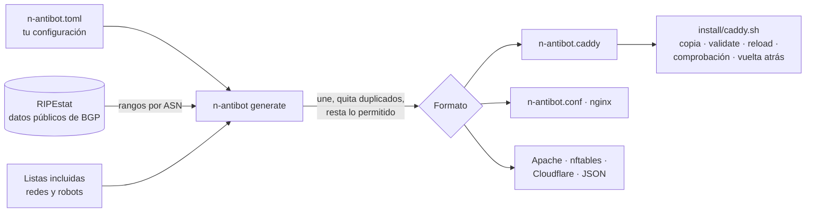

<div align="center">


# N-antibot

**Corta en tu servidor web las redes de bots y los programas de raspado. Sin cuentas, sin claves y sin dependencias.**

[](https://github.com/KrilinZ/N-antibot/actions/workflows/ci.yml)
[](LICENSE)
[](#-compatibilidad)
[](pyproject.toml)
[](#-instalación-en-caddy)
[](#-instalación-en-nginx)
[](docs/es/apache.md)
[](docs/es/nftables.md)
[](docs/es/cloudflare.md)
[](docs/es/node-express.md)

🇪🇸 Español · [🇬🇧 English](README.en.md)

</div>

---

N-antibot genera un pequeño archivo de configuración para **Caddy**, **nginx**, **Apache**, el **cortafuegos de
Linux**, **Cloudflare** o tu aplicación **Node.js** que corta, sin llegar a tu web, dos tipos de visitas:

1. Las que llegan desde **redes de servidores en la nube** de donde salen bots que se hacen pasar por Chrome
   (por defecto, Tencent Cloud).
2. Las de **robots y librerías de raspado** que no traen ningún visitante: Bytespider, MJ12bot, python-requests,
   Scrapy, escáneres de vulnerabilidades…

Google, Bing, los robots de IA, tus clientes y `curl` siguen entrando con normalidad.

```console
$ pip install git+https://github.com/KrilinZ/N-antibot.git
$ n-antibot generate -o n-antibot.caddy
n-antibot: 241 IPv4 + 17 IPv6 ranges, 18 robots -> n-antibot.caddy
$ sudo ./install/caddy.sh --site example.com --snippet n-antibot.caddy --check-url https://example.com
n-antibot: ok   Chrome    -> 200
n-antibot: ok   Googlebot -> 200
n-antibot: ok   curl      -> 200
n-antibot: ok   Bytespider -> 000
n-antibot: installed: example.com is protected
```

## 📚 Índice

- [Por qué existe](#-por-qué-existe)
- [Qué bloquea y qué no](#️-qué-bloquea-y-qué-no)
- [Cómo funciona](#️-cómo-funciona)
- [Guías por tecnología y por caso](#-guías-por-tecnología-y-por-caso)
- [Requisitos](#-requisitos)
- [Compatibilidad](#-compatibilidad)
- [Instalación](#-instalación)
  - [Instalación en Caddy](#-instalación-en-caddy)
  - [Instalación en nginx](#-instalación-en-nginx)
  - [Más tecnologías](#-más-tecnologías)
- [Configuración](#-configuración)
- [Listas incluidas](#-listas-incluidas)
- [Comandos](#️-comandos)
- [Uso desde Python](#-uso-desde-python)
- [Mantener las listas al día](#-mantener-las-listas-al-día)
- [Comprobar que funciona](#-comprobar-que-funciona)
- [Quitarlo](#-quitarlo)
- [Pruebas](#-pruebas)
- [Límites: lo que N-antibot no hace](#-límites-lo-que-n-antibot-no-hace)
- [Preguntas frecuentes](#-preguntas-frecuentes)
- [Estructura del proyecto](#️-estructura-del-proyecto)
- [Contribuir](#-contribuir)
- [Licencia](#-licencia)

## 💡 Por qué existe

Los servicios comerciales contra bots (PerimeterX/HUMAN, DataDome, Cloudflare Bot Management) funcionan bien, pero
suelen exigir contrato, se pagan por peticiones y no todos se pueden poner delante de cualquier servidor. Para una
tienda o una web pequeña, lo que más duele casi siempre es mucho más simple: **tráfico de centros de datos que nunca
va a comprar nada** y **raspadores que ni siquiera disimulan su nombre**.

N-antibot nació en una tienda online real para cortar justo eso, con tres principios:

| Principio | Qué significa |
|---|---|
| **Nada que contratar** | Sin cuentas, sin claves de API, sin JavaScript en tu web y sin dependencias de Python (en 3.9 y 3.10 se instala sola `tomli`, para leer la configuración). |
| **No romper la web** | Buscadores, robots de IA, navegadores reales, `curl` y tus webhooks nunca se tocan. La configuración se rechaza si una regla tuya pudiera cortar a un navegador o a Google. |
| **Todo o nada** | Si falla la descarga de rangos no se escribe ningún archivo. El instalador hace copia, valida, recarga, comprueba en vivo y vuelve atrás solo si algo no cuadra. |

## 🛡️ Qué bloquea y qué no

| Visita | Por defecto | Cómo cambiarlo |
|---|:---:|---|
| Tencent Cloud (AS132203, AS45090) | ⛔ cortada | `[networks] presets` |
| Alibaba Cloud, Huawei Cloud | ✅ pasa | añade `alibaba-cloud`, `huawei-cloud` |
| Cualquier otra red (por ASN o por rango) | ✅ pasa | `[networks] asns` y `block` |
| Bytespider, MJ12bot, DotBot, BLEXBot, PetalBot, MegaIndex, SeekportBot | ⛔ cortada | `[robots] presets` / `allow` |
| python-requests, python-urllib, Go-http-client, Scrapy, aiohttp, libwww-perl | ⛔ cortada | `[robots] allow` |
| zgrab, masscan, Nuclei, sqlmap, Nikto | ⛔ cortada | `[robots] allow` |
| AhrefsBot, SemrushBot y otras herramientas SEO | ✅ pasa | añade el preset `seo-tools` |
| GPTBot, ClaudeBot, CCBot y otros robots de IA | ✅ pasa | añade el preset `ai-training` |
| Googlebot, Bingbot, DuckDuckBot, Yandex, Applebot | ✅ pasa siempre | no se puede bloquear por error |
| Chrome, Safari, Firefox, móviles | ✅ pasa siempre | no se puede bloquear por error |
| `curl`, `wget` | ✅ pasa siempre | son tus herramientas de comprobación |
| Rutas excluidas (`/.well-known/*` y las que añadas) | ✅ pasa siempre | `[paths] exclude` |

> [!IMPORTANT]
> Los robots de IA pasan por defecto a propósito: si quieres que tu web aparezca en las respuestas de ChatGPT,
> Claude o Perplexity (GEO), no los bloquees.

## ⚙️ Cómo funciona



1. **Descarga los rangos** que anuncia cada sistema autónomo (ASN) desde [RIPEstat](https://stat.ripe.net/), que
   publica datos de BGP sin necesidad de cuenta. Hay límite de tiempo, reintentos con espera creciente y validación
   de la respuesta.
2. **Agrupa** los rangos (une los contiguos, elimina los contenidos en otros) y **resta** los que tú marques como
   permitidos.
3. **Genera** el archivo para tu servidor. En cada petición, el servidor mira la IP y el `User-Agent`; si coincide y
   la ruta no está excluida, **cierra la conexión sin responder**. El bot no recibe ni un error: no gasta tu ancho
   de banda ni llega a tu aplicación.

<details>
<summary><b>El detalle de Caddy que más cuesta descubrir</b></summary>

En Caddy, un `handle @matcher` con matcher con nombre se ordena **detrás** de los `handle /ruta/*`. Si tu web tiene
`handle /producto/*` o `handle /api/*`, un bloqueo escrito como `handle @bots { abort }` nunca llegaría a esas rutas.

N-antibot lo resuelve con dos pasos: un `rewrite` (que Caddy ejecuta antes que cualquier `handle`) lleva la petición
a una ruta privada, y un `handle` de **ruta exacta** (que gana a los de prefijo) la aborta:

```caddyfile
rewrite @nAntibotNet /__n_antibot_blocked
rewrite @nAntibotAgent /__n_antibot_blocked
handle /__n_antibot_blocked {
	abort
}
```

Las pruebas arrancan un Caddy real con `handle /producto/*` y comprueban que el corte llega también ahí.
</details>

## 📖 Guías por tecnología y por caso

La documentación completa está en [`docs/es/`](docs/es/README.md). Cada guía dice qué se ha probado y qué no.

| Tecnología | Guía | Qué corta | Probado |
|---|---|---|:---:|
| Caddy | [docs/es/caddy.md](docs/es/caddy.md) | redes y robots | ✅ |
| nginx | [docs/es/nginx.md](docs/es/nginx.md) | redes y robots | ✅ |
| Apache y `.htaccess` | [docs/es/apache.md](docs/es/apache.md) | redes y robots | ✅ |
| Cortafuegos de Linux (nftables) | [docs/es/nftables.md](docs/es/nftables.md) | solo redes | ✅ |
| Node.js y Express | [docs/es/node-express.md](docs/es/node-express.md) | redes y robots | ✅ |
| Next.js y Vercel | [docs/es/vercel-nextjs.md](docs/es/vercel-nextjs.md) | redes y robots | ⚠️ solo la lógica |
| Cloudflare | [docs/es/cloudflare.md](docs/es/cloudflare.md) | redes y robots | ⚠️ sin cuenta real |

| Caso de uso | Configuración lista |
|---|---|
| [Tienda online](docs/es/casos.md#-tienda-online) | [`shop.toml`](examples/cases/shop.toml) |
| [Blog, medio o web corporativa](docs/es/casos.md#-blog-medio-o-web-corporativa) | [`blog.toml`](examples/cases/blog.toml) |
| [Web con API pública](docs/es/casos.md#-web-con-api-pública) | [`public-api.toml`](examples/cases/public-api.toml) |
| [WordPress](docs/es/casos.md#-wordpress) | [`wordpress.toml`](examples/cases/wordpress.toml) |
| [Detrás de un CDN o balanceador](docs/es/casos.md#-detrás-de-un-cdn-o-balanceador) | [`behind-cdn.toml`](examples/cases/behind-cdn.toml) |
| [Protección máxima](docs/es/casos.md#-protección-máxima) | [`strict.toml`](examples/cases/strict.toml) |
| [Sin robots de IA](docs/es/casos.md#-sin-robots-de-ia) | [`no-ai.toml`](examples/cases/no-ai.toml) |
| [Cortar antes del servidor web](docs/es/casos.md#-cortar-antes-del-servidor-web) | [`firewall.toml`](examples/cases/firewall.toml) |
| [Varias webs en un servidor](docs/es/casos.md#-varias-webs-en-un-servidor) · [Me atacan desde otra red](docs/es/casos.md#-me-atacan-desde-otra-red) · [He bloqueado a quien no debía](docs/es/casos.md#-he-bloqueado-a-quien-no-debía) | |

## 📋 Requisitos

| Qué | Versión | Para qué |
|---|---|---|
| Python | 3.9 o superior | Ejecutar `n-antibot` (solo biblioteca estándar; en 3.9 y 3.10, además `tomli`) |
| Caddy | 2.x | Si usas la salida `caddy` |
| nginx | 1.x con `geo` y `map` (vienen de serie) | Si usas la salida `nginx` |
| Apache | 2.4 con `mod_rewrite` | Si usas la salida `apache` |
| nftables | Linux, como root | Si usas la salida `nftables` |
| Node.js | 18 o superior | Si usas el middleware de `integrations/node/` |
| Salida a Internet | hacia `stat.ripe.net` | Solo al generar las listas, no al servir la web |

No hace falta instalar nada en la máquina del servidor si generas el archivo en otra y lo copias.

## 🧬 Compatibilidad

Estas son las versiones con las que se ejecutan las pruebas en cada cambio
([integración continua](https://github.com/KrilinZ/N-antibot/actions/workflows/ci.yml)). Lo que no aparece aquí no
está probado, aunque pueda funcionar.

| Pieza | Versiones probadas | Cómo |
|---|---|---|
| **Python** | 3.9, 3.10, 3.11, 3.12, 3.13 y 3.14 | Todas las pruebas, en cada versión |
| **Sistemas** | Ubuntu 22.04, 24.04 y 26.04, macOS | Las pruebas de los servidores disponibles en cada sistema |
| **Windows** | Windows Server (GitHub) | Solo el generador y la línea de comandos: no hay servidores que probar |
| **Caddy** | 2.6.2 (Ubuntu 24.04 y 26.04) y 2.11 (macOS) | De punta a punta |
| **nginx** | 1.18 (Ubuntu 22.04), 1.24 (Ubuntu 24.04) y 1.31 (macOS) | De punta a punta |
| **Apache** | 2.4.52, 2.4.58, 2.4.66 y 2.4.67 | De punta a punta, en `<VirtualHost>` y en `.htaccess` |
| **nftables** | 1.0.2 (Ubuntu 22.04) y 1.0.9 (Ubuntu 24.04) | De punta a punta: carga las reglas y comprueba el corte |
| **Node.js** | 18, 20, 22 y 24 | El middleware, con un servidor HTTP real |
| **Cloudflare** | | Sin probar en una cuenta: expresión contrastada con su documentación |
| **Vercel** | | Sin probar en un despliegue: solo la lógica del middleware |

| Compatible con… | Detalle |
|---|---|
| **IPv4 e IPv6** | En todas las salidas. El middleware de Node entiende además las IPv4 escritas dentro de IPv6 (`::ffff:1.2.3.4`). |
| **HTTP/1.1, HTTP/2 y HTTP/3** | El corte se hace por IP, `User-Agent` y ruta, que existen en los tres. El cortafuegos cubre TCP y UDP. |
| **Proxies y CDN** | Con la IP real configurada: `client_ip` en Caddy, `realip` en nginx, `mod_remoteip` en Apache. |
| **Docker** | El archivo se monta en el contenedor; el cortafuegos cubre también los puertos publicados por Docker. |
| **Tus reglas actuales** | Caddy: un `import`. nginx: variables con prefijo propio. Apache: reglas `Rewrite` que conviven con las tuyas. nftables: tabla aparte. Nada sobrescribe lo que ya tienes. |
| **Alojamiento compartido** | Por `.htaccess`, si el alojamiento usa Apache 2.4 con `mod_rewrite`. |
| **Salida en texto plano** | Los archivos generados y los mensajes son ASCII: no dan problemas de codificación en ninguna consola. |

## 🚀 Instalación

```bash
pip install git+https://github.com/KrilinZ/N-antibot.git
```

O aislado, con [pipx](https://pipx.pypa.io/):

```bash
pipx install git+https://github.com/KrilinZ/N-antibot.git
```

Para fijar una versión concreta añade la etiqueta al final: `...N-antibot.git@v0.3.0`.

### 🟦 Instalación en Caddy

**1. Crea tu configuración** (opcional: sin ella se usan los valores por defecto).

```bash
n-antibot init -o n-antibot.toml
```

**2. Genera el archivo.**

```bash
n-antibot generate -c n-antibot.toml -o n-antibot.caddy
```

**3. Instálalo con el instalador seguro** (en el servidor, como root).

```bash
sudo ./install/caddy.sh --site example.com --snippet n-antibot.caddy --check-url https://example.com
```

El instalador hace esto, en orden, y **vuelve atrás solo** si algo falla:

| Paso | Qué hace |
|:---:|---|
| 1 | Copia el `Caddyfile` y el archivo anterior a `/var/backups/n-antibot/<fecha>/` |
| 2 | Copia el archivo nuevo a `/etc/caddy/n-antibot.caddy` |
| 3 | Añade `import /etc/caddy/n-antibot.caddy` como primera línea del bloque de tu web (solo una vez) |
| 4 | `caddy validate` y, si pasa, `caddy reload` |
| 5 | Con `--check-url`: Chrome, Googlebot y curl deben recibir respuesta, y Bytespider debe quedar cortado |

<details>
<summary><b>Opciones del instalador</b></summary>

| Opción | Por defecto | Descripción |
|---|---|---|
| `--site DIRECCIÓN` | (obligatoria) | El bloque a proteger, tal como empieza la línea en el Caddyfile (`example.com {`) |
| `--snippet ARCHIVO` | (obligatoria) | El archivo creado por `n-antibot generate` |
| `--caddyfile ARCHIVO` | `/etc/caddy/Caddyfile` | Tu Caddyfile |
| `--dest ARCHIVO` | `/etc/caddy/n-antibot.caddy` | Dónde se instala |
| `--backup-dir CARPETA` | `/var/backups/n-antibot` | Dónde se guardan las copias |
| `--address HOST:PUERTO` | el de Caddy | Punto de administración de Caddy para la recarga |
| `--check-url URL` | (ninguna) | Comprobación en vivo tras recargar |
| `--uninstall` | | Quita la línea `import` y recarga |

</details>

<details>
<summary><b>Instalación a mano</b></summary>

```caddyfile
example.com {
	# Tiene que ser la PRIMERA línea del bloque.
	import /etc/caddy/n-antibot.caddy

	handle /api/* {
		reverse_proxy 127.0.0.1:3000
	}
	handle {
		root * /var/www/example
		file_server
	}
}
```

```bash
sudo cp n-antibot.caddy /etc/caddy/n-antibot.caddy
sudo caddy validate --config /etc/caddy/Caddyfile --adapter caddyfile
sudo caddy reload --config /etc/caddy/Caddyfile --adapter caddyfile
```

</details>

> [!NOTE]
> ¿Tu Caddy está detrás de Cloudflare o de un balanceador? Pon `ip_matcher = "client_ip"` en `[caddy]` y configura
> `trusted_proxies` en Caddy. Si no, Caddy vería la IP del proxy y no la del visitante.

### 🟩 Instalación en nginx

**1. Genera el archivo.**

```bash
n-antibot generate -c n-antibot.toml -f nginx -o n-antibot.conf
sudo cp n-antibot.conf /etc/nginx/n-antibot.conf
```

**2. Inclúyelo una vez dentro de `http { }`** y añade una línea en cada `server` que quieras proteger.

```nginx
http {
	include /etc/nginx/n-antibot.conf;

	server {
		server_name example.com;

		if ($n_antibot_block) { return 444; }

		# ... el resto de tu configuración
	}
}
```

**3. Valida y recarga.**

```bash
sudo nginx -t && sudo nginx -s reload
```

`444` es el código especial de nginx para **cerrar la conexión sin responder**, lo mismo que hace `abort` en Caddy.

El archivo define cuatro variables:

| Variable | Valor `1` cuando… |
|---|---|
| `$n_antibot_net` | la IP está en una red bloqueada (`geo`) |
| `$n_antibot_agent` | el `User-Agent` coincide con un robot bloqueado (`map`) |
| `$n_antibot_excluded` | la ruta está en `[paths] exclude` |
| `$n_antibot_block` | hay que cortar: red o robot, y la ruta no está excluida |

> [!NOTE]
> Detrás de un proxy o CDN, configura el módulo `realip` de nginx (`set_real_ip_from`, `real_ip_header`) para que
> `geo` vea la IP real del visitante.

### 🟨 Más tecnologías

| Tu web pasa por… | Comando | Guía |
|---|---|---|
| Apache o un `.htaccess` | `n-antibot generate -f apache -o n-antibot.conf` | [Apache](docs/es/apache.md) |
| El cortafuegos de Linux | `n-antibot generate -f nftables -o n-antibot.nft` | [nftables](docs/es/nftables.md) |
| Cloudflare | `n-antibot generate -f cloudflare \| tail -1` | [Cloudflare](docs/es/cloudflare.md) |
| Node.js o Express | `n-antibot generate -f json -o n-antibot.json` | [Node.js y Express](docs/es/node-express.md) |
| Next.js o Vercel | `n-antibot generate -f json -o n-antibot.json` | [Next.js y Vercel](docs/es/vercel-nextjs.md) |

Para cualquier otra cosa (otro CDN, fail2ban, tu propio código), la salida en JSON trae las listas en limpio:

```bash
n-antibot generate -f json -o n-antibot.json
```

```json
{
  "generator": "n-antibot 0.3.0",
  "generated_on": "2026-11-12",
  "asns": ["AS132203", "AS45090"],
  "ipv4": ["1.12.0.0/14", "1.116.0.0/15", "…"],
  "ipv6": ["2402:4e00::/32", "…"],
  "user_agents": ["Bytespider", "MJ12bot", "…"],
  "user_agent_regex": "(?i)(Bytespider|MJ12bot|…)",
  "exclude_paths": ["/.well-known/*"]
}
```

## 🧩 Configuración

Un único archivo TOML. **Todas las claves son opcionales.** Créalo con `n-antibot init -o n-antibot.toml`.

```toml
[networks]
presets = ["tencent-cloud"]        # redes en la nube a bloquear
asns    = ["AS45102"]              # sistemas autónomos adicionales
block   = ["203.0.113.0/24"]       # rangos sueltos que quieres cortar
allow   = ["43.153.10.20/32"]      # rangos que NUNCA se cortan (tu servidor, tu monitor)

[robots]
presets = ["aggressive-crawlers", "scraping-libraries", "vulnerability-scanners"]
block   = ["BadBot"]               # fragmentos adicionales del User-Agent
allow   = ["aiohttp"]              # sácalos de las listas incluidas

[paths]
exclude = ["/.well-known/*", "/api/*", "/webhooks/*", "/health"]

[output]
format = "caddy"                   # caddy | nginx | apache | nftables | cloudflare | json

[caddy]
prefix     = "nAntibot"
block_path = "/__n_antibot_blocked"
ip_matcher = "remote_ip"           # o "client_ip" detrás de un proxy

[nginx]
prefix = "n_antibot"

[nftables]
table = "n_antibot"
ports = [80, 443]
```

### Referencia completa

| Clave | Tipo | Por defecto | Descripción |
|---|---|---|---|
| `networks.presets` | lista | `["tencent-cloud"]` | Redes incluidas a bloquear. Ver [listas](#-listas-incluidas). |
| `networks.asns` | lista | `[]` | ASN adicionales, con el formato `AS12345`. |
| `networks.block` | lista | `[]` | Rangos adicionales (`203.0.113.0/24`, `2001:db8::/32`). |
| `networks.allow` | lista | `[]` | Rangos que se **restan** de lo bloqueado, aunque estén dentro de una red cortada. |
| `robots.presets` | lista | las 3 familias por defecto | Familias de robots a bloquear. |
| `robots.block` | lista | `[]` | Fragmentos adicionales. Se buscan en cualquier parte del `User-Agent`, sin distinguir mayúsculas. |
| `robots.allow` | lista | `[]` | Fragmentos que se quitan de las familias. |
| `paths.exclude` | lista | `["/.well-known/*"]` | Rutas que nunca se cortan. Formas: `/exacta`, `/prefijo/*`, `*.ext`. |
| `output.format` | texto | `"caddy"` | `caddy`, `nginx`, `apache`, `nftables`, `cloudflare` o `json`. Se puede cambiar con `-f`. |
| `caddy.prefix` | texto | `"nAntibot"` | Prefijo de los matchers del archivo. |
| `caddy.block_path` | texto | `"/__n_antibot_blocked"` | Ruta privada donde se aborta. |
| `caddy.ip_matcher` | texto | `"remote_ip"` | `remote_ip` (conexión directa) o `client_ip` (detrás de proxy). |
| `nginx.prefix` | texto | `"n_antibot"` | Prefijo de las variables de nginx. |
| `nftables.table` | texto | `"n_antibot"` | Nombre de la tabla del cortafuegos. |
| `nftables.ports` | lista de números | `[80, 443]` | Puertos protegidos (TCP y UDP). |

### Validaciones que te protegen

La configuración se rechaza, con un mensaje que dice qué clave falla y por qué, cuando:

| Caso | Ejemplo | Mensaje |
|---|---|---|
| Sección o clave mal escrita | `[netwroks]` | `unknown section [netwroks]` |
| Un robot que cortaría a un navegador o buscador | `block = ["Mozilla"]` | `'Mozilla' would block a real browser or search engine` |
| Un fragmento con símbolos de expresión regular | `block = ["bad\|bot"]` | `must be 3-64 characters of letters, digits, '_' or '-'` |
| Un fragmento demasiado corto | `block = ["ab"]` | ídem |
| Un rango o un ASN que no lo son | `asns = ["132203"]` | `is not an ASN like 'AS132203'` |
| Una ruta con forma no admitida | `exclude = ["/a/*/b"]` | `must be '/exact', '/prefix/*' or '*.ext'` |
| Todas las listas vacías | | `nothing to block` |

> [!WARNING]
> Excluye siempre las rutas a las que llaman **otros servidores**: webhooks de pagos, APIs que consumen tus
> integraciones, comprobaciones de estado. Muchas integraciones usan python-requests o Go, y quedarían cortadas.

## 📦 Listas incluidas

Míralas en cualquier momento con `n-antibot presets`.

### Redes

| Preset | Por defecto | ASN | Descripción |
|---|:---:|---|---|
| `tencent-cloud` | ✅ | AS132203, AS45090 | Tencent Cloud internacional y China. Origen habitual de bots que imitan a Chrome. |
| `alibaba-cloud` | | AS45102 | Alibaba Cloud. |
| `huawei-cloud` | | AS136907 | Huawei Cloud. |

### Robots

| Preset | Por defecto | Fragmentos | Descripción |
|---|:---:|---|---|
| `aggressive-crawlers` | ✅ | Bytespider, MJ12bot, DotBot, BLEXBot, PetalBot, MegaIndex, SeekportBot | Rastreadores que no traen visitas y cargan la web. |
| `scraping-libraries` | ✅ | python-requests, python-urllib, Go-http-client, Scrapy, aiohttp, libwww-perl | Librerías HTTP usadas por raspadores. Sin `curl` ni `wget`. |
| `vulnerability-scanners` | ✅ | zgrab, masscan, Nuclei, sqlmap, Nikto | Escáneres de puertos y vulnerabilidades. |
| `seo-tools` | | AhrefsBot, SemrushBot, DataForSeoBot, serpstatbot, Barkrowler | Herramientas SEO comerciales. Bloquearlas solo oculta tu web en esas herramientas. |
| `ai-training` | | GPTBot, ClaudeBot, anthropic-ai, CCBot, meta-externalagent, Amazonbot, cohere-ai | Robots de IA. Bloquearlos saca tu web de las respuestas de las IA. |

## 🖥️ Comandos

| Comando | Qué hace | Código de salida |
|---|---|---|
| `n-antibot generate [-c CFG] [-f FORMATO] [-o ARCHIVO]` | Descarga rangos y escribe el archivo (o lo imprime). | `0` bien |
| `n-antibot check [-c CFG] [-f FORMATO] -o ARCHIVO` | Dice si el archivo está al día. | `0` al día · `1` desactualizado |
| `n-antibot test-agent [-c CFG] "USER-AGENT"` | ¿Se cortaría este `User-Agent`? No usa la red. | `0` cortado · `2` pasa |
| `n-antibot test-ip [-c CFG] IP` | ¿Se cortaría esta IP? | `0` cortada · `2` pasa |
| `n-antibot presets` | Lista las redes y robots incluidos. | `0` |
| `n-antibot init [-o ARCHIVO]` | Crea una configuración de ejemplo (no sobrescribe). | `0` · `1` si ya existe |
| `n-antibot --version` | Versión. | `0` |

Códigos de error comunes a todos: `3` configuración no válida · `4` no se pudo leer RIPEstat (no se escribe nada).

```console
$ n-antibot test-agent "Mozilla/5.0 (compatible; Bytespider; spider-feedback@bytedance.com)"
BLOCKED by 'Bytespider'

$ n-antibot test-agent "Mozilla/5.0 (compatible; Googlebot/2.1; +http://www.google.com/bot.html)"
allowed

$ n-antibot test-ip 43.173.132.9
BLOCKED by 43.173.0.0/16

$ n-antibot test-ip 66.249.66.1
allowed

$ n-antibot check -o /etc/caddy/n-antibot.caddy
/etc/caddy/n-antibot.caddy: up to date
```

## 🐍 Uso desde Python

```python
from n_antibot import Config, generate, load

# Con los valores por defecto
print(generate(Config().validate()))

# Desde un archivo
cfg = load("n-antibot.toml")
texto = generate(cfg)

# ¿Se cortaría este User-Agent?
cfg.blocks_agent("python-requests/2.32")   # -> 'python-requests'
cfg.blocks_agent("Mozilla/5.0 ... Chrome") # -> None
```

| Objeto | Descripción |
|---|---|
| `Config` | Configuración inmutable. `.validate()` la comprueba; `.agents()`, `.all_asns()` y `.blocks_agent(ua)` dan las listas finales. |
| `load(ruta)` | Lee y valida un TOML (`None` da los valores por defecto). |
| `generate(cfg)` | Devuelve el texto del archivo en el formato de `cfg.format`. |
| `ConfigError` | La configuración no es válida. |
| `FetchError` | No se pudo leer RIPEstat. |

## 🔄 Mantener las listas al día

Las redes en la nube cambian sus rangos. Regenera el archivo cada cierto tiempo; una vez por semana es suficiente.
[`examples/n-antibot-update.sh`](examples/n-antibot-update.sh) lo hace para Caddy: comprueba si hay cambios, genera,
valida y recarga, y **conserva el archivo anterior** si el nuevo no valida.

```cron
# /etc/cron.d/n-antibot — lunes a las 4:00
0 4 * * 1  root  /usr/local/bin/n-antibot-update.sh
```

Si prefieres decidir tú cuándo cambia, guarda el archivo generado en tu repositorio y usa `n-antibot check` en tu
integración continua: avisa (código `1`) cuando las listas han cambiado.

## ✅ Comprobar que funciona

Desde cualquier ordenador, con `curl`:

```bash
# Un navegador: debe responder 200
curl -s -o /dev/null -w '%{http_code}\n' -A 'Mozilla/5.0 (Macintosh) AppleWebKit/537.36 Chrome/131.0 Safari/537.36' https://example.com/

# Google: debe responder 200
curl -s -o /dev/null -w '%{http_code}\n' -A 'Mozilla/5.0 (compatible; Googlebot/2.1; +http://www.google.com/bot.html)' https://example.com/

# Un raspador: 000 (conexión cortada)
curl -s -o /dev/null -w '%{http_code}\n' -A 'python-requests/2.32.3' https://example.com/

# Una ruta excluida, con el mismo raspador: debe responder
curl -s -o /dev/null -w '%{http_code}\n' -A 'python-requests/2.32.3' https://example.com/.well-known/security.txt
```

| Resultado | Significado |
|---|---|
| `200`, `301`, `404`… | La petición pasa y tu web responde. |
| `000` | Conexión cortada por N-antibot: el servidor cierra sin enviar respuesta. |

## 🧹 Quitarlo

**Caddy**, con el instalador:

```bash
sudo ./install/caddy.sh --site example.com --uninstall
```

A mano: borra la línea `import /etc/caddy/n-antibot.caddy` y recarga Caddy.

**nginx:** borra la línea `if ($n_antibot_block) { return 444; }` y el `include`, y recarga con
`sudo nginx -t && sudo nginx -s reload`.

## 🧪 Pruebas

```bash
git clone https://github.com/KrilinZ/N-antibot.git && cd N-antibot
pip install -e . pytest ruff
pytest -q
node --test tests/node/n-antibot.test.mjs
ruff check src tests && ruff format --check src tests
```

| Archivo | Qué comprueba |
|---|---|
| [`tests/test_unit.py`](tests/test_unit.py) | Agrupación y resta de rangos, validación de la respuesta de RIPEstat, reintentos, cada regla de la configuración, que ninguna lista incluida corte a un navegador o buscador, los tres formatos de salida y la línea de comandos. |
| [`tests/test_servers.py`](tests/test_servers.py) | **De punta a punta:** arranca un Caddy, un nginx y un Apache reales con el archivo generado y lanza peticiones. Chrome, Googlebot y curl reciben `200`; Bytespider y python-requests quedan cortados, también en rutas con `handle` propio y desde un `.htaccess`; las rutas excluidas responden. En Linux carga además las reglas de nftables y comprueba que la red bloqueada deja de conectar. Cada prueba se omite si su servidor no está instalado. |
| [`tests/node/n-antibot.test.mjs`](tests/node/n-antibot.test.mjs) | El middleware de Node con un servidor HTTP real: rangos IPv4 e IPv6, robots, rutas excluidas, corte de conexión y modo 403. |

## 🚧 Límites: lo que N-antibot no hace

Conviene saberlo antes de instalarlo:

- **No detecta bots por comportamiento.** No hay huella de navegador, retos de JavaScript ni CAPTCHA. Un bot que
  salga de una IP doméstica (proxies residenciales) con un `User-Agent` de Chrome pasa.
- **El `User-Agent` se puede falsear.** Un raspador que cambie su nombre no cae en la lista de robots, aunque sí en
  la de redes si sale de una red bloqueada.
- **Bloquear una red entera tiene coste.** Si un cliente tuyo real navega desde un servidor de esa red (una VPN
  alojada ahí, por ejemplo), quedará cortado. Para eso está `networks.allow`.
- **No sustituye a un cortafuegos de aplicación (WAF)** ni a la limitación de peticiones por IP.
- **Depende de RIPEstat** en el momento de generar. Si no responde, no se genera nada y tu archivo anterior sigue
  funcionando.

## ❓ Preguntas frecuentes

<details>
<summary><b>¿Afecta al SEO?</b></summary>

No. Googlebot, Bingbot, DuckDuckBot, Yandex y Applebot no están en ninguna lista y la configuración se rechaza si
una regla tuya pudiera cortarlos. Las pruebas lo comprueban con sus `User-Agent` reales.
</details>

<details>
<summary><b>¿Y a mi aparición en ChatGPT, Claude o Perplexity?</b></summary>

Tampoco: los robots de IA pasan por defecto. Solo se bloquean si añades tú el preset `ai-training`.
</details>

<details>
<summary><b>¿Por qué cortar la conexión en lugar de responder 403?</b></summary>

Porque responder cuesta. Con el corte, el bot no recibe cabeceras ni cuerpo y tu aplicación ni se entera de la
petición.
</details>

<details>
<summary><b>¿Puedo proteger varias webs en el mismo servidor?</b></summary>

Sí. En Caddy, importa el mismo archivo en cada bloque (o ejecuta el instalador una vez por web). En nginx, el
`include` va una sola vez en `http { }` y la línea `if` en cada `server`.
</details>

<details>
<summary><b>Un servicio mío usa python-requests contra mi web y ha dejado de funcionar.</b></summary>

Tres salidas, de más a menos recomendable: excluye la ruta que usa (`paths.exclude`), cámbiale el `User-Agent` a tu
servicio, o saca el fragmento de la lista (`robots.allow = ["python-requests"]`).
</details>

<details>
<summary><b>¿Cuántas reglas añade?</b></summary>

Con la configuración por defecto, unos 260 rangos de IP y una expresión regular con 18 nombres. La cifra exacta
sale al generar: `241 IPv4 + 17 IPv6 ranges, 18 robots`.
</details>

<details>
<summary><b>¿Funciona detrás de Cloudflare?</b></summary>

Sí, si tu servidor conoce la IP real del visitante: `ip_matcher = "client_ip"` y `trusted_proxies` en Caddy, o el
módulo `realip` en nginx. Sin eso, la lista de robots funciona igual, pero la de redes compararía la IP de
Cloudflare.
</details>

<details>
<summary><b>¿Cómo sé qué ASN bloquear?</b></summary>

Mira en tus registros de acceso las IP que más peticiones hacen y búscalas en
[stat.ripe.net](https://stat.ripe.net/): te dice a qué ASN pertenecen. Añádelo en `networks.asns`.
</details>

## 🗂️ Estructura del proyecto

```text
N-antibot/
├── src/n_antibot/
│   ├── presets.py      # redes y robots incluidos, y los User-Agent que nunca se cortan
│   ├── config.py       # configuración TOML y sus validaciones
│   ├── ranges.py       # descarga de RIPEstat, agrupación y resta de rangos
│   ├── render.py       # salidas: Caddy, nginx, Apache, nftables, Cloudflare y JSON
│   ├── core.py         # generate(): de la configuración al archivo
│   ├── cli.py          # línea de comandos
│   └── example.toml    # configuración de ejemplo (n-antibot init)
├── install/caddy.sh    # instalador seguro para Caddy
├── integrations/node/  # middleware para Node.js, Express y Next.js
├── docs/es/ · docs/en/ # guías por tecnología y por caso de uso
├── examples/           # Caddyfile, nginx.conf, actualización semanal y cases/ (configuraciones por caso)
├── tests/              # unitarias y de punta a punta con servidores reales
└── assets/logo.png
```

## 🤝 Contribuir

Las propuestas son bienvenidas, sobre todo:

- **Robots o redes nuevas**, con una referencia de por qué merecen estar (registros, documentación del robot).
- **Salidas para otros servidores** (HAProxy, Traefik, IIS).
- **Errores**: abre una [incidencia](https://github.com/KrilinZ/N-antibot/issues) con tu configuración y la salida.

Antes de enviar cambios, ejecuta `pytest -q` y `ruff check src tests`.

## 📄 Licencia

[MIT](LICENSE) © 2026 Nacho López.

Los rangos de IP proceden de [RIPEstat](https://stat.ripe.net/), el servicio de datos públicos del RIPE NCC.

<div align="center">
<br>

<br>
<sub><b>N-antibot</b> · Secure your digital ecosystem</sub>
</div>
